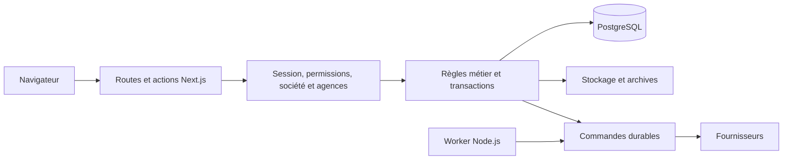

# Parcours de revue technique

Freelio présente une application métier de démonstration. Cette page propose une lecture de 30 minutes : suivre trois invariants, examiner leurs tests et vérifier les limites de la livraison. Elle ne remplace pas la revue du code ou l’exécution de la recette.

## 1. Situer l’application — 5 minutes

Lire le [README](../README.md), les [décisions techniques](decisions-techniques.md) et le [périmètre qualifié](coverage-and-external-dependencies.md). Le système reste un monolithe Next.js avec un worker distinct, PostgreSQL pour les environnements partagés et SQLite pour une démo isolée.

Ce schéma décrit le code disponible. Dans la démo publique, les mutations, fournisseurs, traitements métier et stockage persistant sont désactivés. Les fixtures de messagerie ne représentent pas des connexions actives.

## 2. Suivre trois invariants — 15 minutes

### Un aperçu de facture ne doit pas changer silencieusement

Le calcul commercial utilise des centimes et un arrondi par ligne. La facturation des temps part des secondes exactes. L’action vérifie les versions présentées, puis recontrôle les données dans la transaction. Une modification concurrente provoque un refus ; elle ne produit pas une facture avec un montant différent de l’aperçu accepté.

Lire [le calcul commercial](../src/lib/finance/commercial-calculation.ts), [les lignes de temps](../src/lib/finance/time-invoice-lines.ts), [leur version](../src/lib/finance/time-invoice-version.ts) et les [frontières métier](architecture-domain-boundaries.md#1-calcul-commercial-et-facturation). Après émission, le document archivé est conservé ; une archive historique absente n’est pas reconstituée comme un original.

### Un objet autorisé peut contenir une relation interdite

Le contrôle de la société racine ne suffit pas : client, responsable, facture, site ou dépôt liés peuvent être incohérents. Les lecteurs doivent exclure les données inaccessibles du payload et des agrégats, pas seulement les cacher dans le composant.

Lire [le contexte d’autorisation](../src/lib/auth-wrapper.ts), [le client Prisma](../src/lib/prisma.ts) et [les lectures Opérations](../src/actions/operations/queries.ts). Les [tests des relations Opérations](../tests/unit/operations-details-relations.integration.test.ts) construisent des références contradictoires pour vérifier la réponse complète.

### Un envoi incertain ne doit pas être relancé aveuglément

Un fournisseur peut accepter un message avant qu’une panne empêche l’écriture locale du résultat. Les commandes durables, quotas et états de reprise conservent ce cas. Une preuve d’acceptation permet de réparer l’historique sans renvoi ; un classement conserve la trace et bloque la relance.

Lire la décision [D06](decisions-techniques.md#d06--envois-durables-et-reprise-explicite) et les [tests de reprise manuelle](../tests/unit/manual-email-recovery.integration.test.ts). Les transports simulés vérifient le contrat applicatif ; ils ne prouvent ni la délivrabilité ni la disponibilité d’une boîte réelle.

## 3. Examiner la preuve — 5 minutes

Le [guide de test](testing.md) distingue règles pures, SQL SQLite/PostgreSQL, navigateur desktop/mobile et runtime Linux. Les chiffres des deux suites SQLite ne s’additionnent pas. La couverture chiffrée concerne les modules explicitement sélectionnés dans [Vitest](../vitest.config.mts).

Pour une livraison, examiner le SHA réellement testé, les quatre contrôles obligatoires de `main`, les exclusions et la révision de l’artefact servi. Une relance réussie ne supprime pas la première tentative échouée. Les [archives](history.md) gardent les incidents et les anciennes preuves à leur révision.

La recette locale utilise une base fictive isolée et les dépendances du lockfile. Suivre [le guide de contribution](../CONTRIBUTING.md) et [le démarrage démo](demo-local.md), sans fournir les secrets de la démonstration hébergée.

## 4. Discuter les limites — 5 minutes

Les principales décisions à examiner sont Auth.js beta, Chromium sans sandbox système, la coexistence SQLite/PostgreSQL, les anciennes références sans FK et la reprise des effets externes incertains. Les guides décrivent ces compromis ; leur présence ne les rend pas automatiquement acceptables pour tout usage.

Avant un service commercial, il reste à qualifier les comptes fournisseur réels, les fichiers persistants, la récupération conjointe chez l’hébergeur, la charge attendue et les responsabilités de l’exploitant. La démonstration ne revendique ni SLA, ni certification Factur-X/WCAG, ni audit indépendant.

Un problème de sécurité se signale par [le canal privé](../SECURITY.md). Une évolution fonctionnelle doit préciser le cas d’usage, les permissions, les données modifiées et le comportement en cas d’échec. Le [modèle de PR](../.github/pull_request_template.md) demande les preuves exécutées et les limites.
